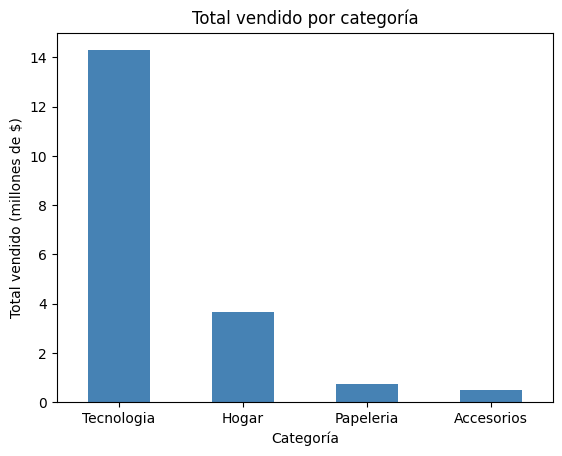
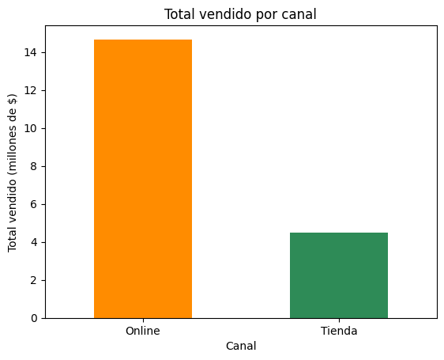
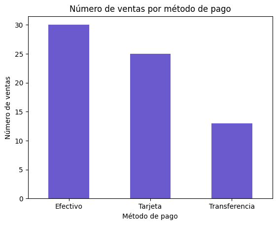

# Taller práctico: análisis de datos con Pandas

Programa de consola que lee datos de ventas y clientes, los limpia, los une y los analiza. Se ejecuta desde un menú en la terminal, y cada opción corresponde a un módulo que vas a completar paso a paso.

Recuerda consultar la guía adjunta en PDF donde se te dará el paso a paso del trabajo.

## Requisitos

- Python 3.10 o superior
- Git (para clonar el repositorio)
- Conocimientos básicos de variables, listas y funciones

## Cómo empezar

1. Clona el repositorio y entra a la carpeta del proyecto:

   ```
   git clone <URL-DEL-REPOSITORIO>
   cd <NOMBRE-DE-LA-CARPETA>
   ```

2. Crea y activa un ambiente virtual. Las instrucciones completas, para Windows y Mac/Linux, están en `LEEME_ambiente.txt`.

3. Instala las librerías:

   ```
   pip install -r requirements.txt
   ```

4. Ejecuta el programa:

   ```
   python main.py
   ```

Ejecuta siempre los comandos desde la carpeta del proyecto. Los módulos buscan los archivos a partir de su ubicación.

## Estructura del proyecto

```
├── main.py            Menú principal. No lo modifiques.
├── carga.py           Lee los CSV. Ya está completo.
├── limpieza.py        Limpia clientes y ventas. TODO 1 a 5.
├── merge.py           Valida y une las tablas. TODO 6 y 7.
├── analisis.py        Responde las preguntas de negocio. TODO 8 a 12.
├── graficos.py        Dibuja dos gráficos sencillos. TODO 13 y 14.
├── exploracion.py     Ejemplos de indexación, .loc, .iloc y concat. Se ejecuta por separado.
├── requirements.txt   Versiones de las librerías.
├── LEEME_ambiente.txt Pasos para crear el ambiente virtual.
└── Data/
    ├── raw/           Datos originales (cliente.csv, ventas.csv). No los modifiques.
    └── processed/     Resultados que genera el programa.
```

## Menú

| Opción | Qué hace |
|---|---|
| 1 | Carga los archivos CSV |
| 2 | Limpia los datos |
| 3 | Valida y une las tablas con merge |
| 4 | Muestra el análisis y las respuestas del desafío |
| 5 | Dibuja los gráficos de introducción |
| 6 | Sale del programa |

Las opciones se usan en orden: primero cargar (1), luego limpiar (2), después unir (3) y finalmente analizar (4) o graficar (5).

## Cómo completar el taller

1. Abre el archivo indicado en cada TODO. Cada función tiene un docstring con pistas.
2. Completa el TODO y ejecuta `python main.py` para probar la opción correspondiente.
3. Usa `exploracion.py` para practicar indexación, `.loc`, `.iloc` y `concat()` antes de aplicarlos en tu código.

Las funciones que aún no completaste no dan error: devuelven los datos sin cambios, así que el menú siempre funciona.

## Entregables

Consulta el documento del taller (`guia_Taller_Pandas.pdf`) para ver el detalle de cada entregable y la rúbrica. En resumen:

- Entregable 0: pantallazo del ambiente virtual activo y de la instalación.
- Entregable 1: pantallazos de `.shape`, `.info()` y `.describe()`, y salida de `exploracion.py`.
- Entregable 2: limpieza, con pantallazos antes y después y explicación.
- Entregable 3: validación, merge y análisis, con pantallazos de las opciones 3 y 4.
- Entregable 4: los dos gráficos (`.png`) y el código de `graficos.py`.
- Desafío final: respuestas a las cinco preguntas, con el criterio usado en cada una.

Para entregar, agrega al final de este `README.md` una sección con tu nombre y tus respuestas a las preguntas del desafío. Sube tus cambios al repositorio y envía el enlace por el formulario de entrega. La entrega es individual.

## Preguntas de negocio

1. ¿Qué categoría genera más ingresos?
2. ¿Qué canal vende más?
3. ¿Los clientes VIP compran más que los Regulares?
4. ¿Qué método de pago es el más usado?
5. ¿Cuáles son los cinco clientes con más compras?

---

# Entrega

**Estudiante:** Juan David López
**Docente:** Diego Giraldo Zapata, Nuevas tecnologías (CESDE)

Las capturas de pantalla y los gráficos están en la carpeta [`images/`](images/).

## Entregable 0: ambiente virtual

Ambiente creado con `python -m venv venv`, activado con `venv\Scripts\Activate.ps1` y librerías instaladas con `pip install -r requirements.txt` (pandas 3.0.2, matplotlib 3.10.8, seaborn 0.13.2).

## Entregable 1: exploración

- `ventas.csv` tiene la forma `(68, 10)` y `cliente.csv` tiene `(60, 5)`.
- Según `.info()`, la columna `producto` de ventas tiene **67 valores no nulos de 68**, así que le falta un dato. Además, `fecha_venta` está guardada como texto (`str`), no como fecha.
- **¿Por qué `.iloc[2, 6]` devuelve el total de la venta V003?** Después de `set_index("id_venta")`, `id_venta` deja de ser una columna y pasa a ser el índice. Las columnas quedan así, contando desde 0: `id_cliente`(0), `fecha_venta`(1), `producto`(2), `categoria`(3), `cantidad`(4), `precio_unitario`(5), `total`(6). La fila en la posición 2 (tercera fila) es V003, y la columna en la posición 6 es `total`. Por eso `.iloc[2, 6]` y `.loc["V003", "total"]` devuelven lo mismo: 520000.
- `.loc["V001":"V006"]` devuelve 6 filas porque `.loc` incluye el final del rango. `.iloc[0:5]` devuelve 5 porque `.iloc` no lo incluye.
- `concat` une abril (60 filas) y mayo (8 filas) y da 68 filas, las mismas de la tabla original.

## Entregable 2: limpieza

Revisé nulos (`isnull().sum()`), duplicados (`duplicated().sum()`), espacios sobrantes y valores escritos de forma distinta (`value_counts()` en ciudad, segmento, categoría, canal y método de pago). Los datos venían bastante limpios. Los problemas que encontré fueron:

1. **Un producto vacío** en la venta V004. Lo rellené con `fillna("Sin especificar")`. **No usé `dropna()`** porque esa venta tiene un total real de $780.000, y si la borraba los ingresos de Tecnología, del canal Online y del cliente quedarían mal. Lo único que falta es el nombre del producto; el dinero de la venta sí existe.
2. **`fecha_venta` era texto.** La convertí con `pd.to_datetime(..., format="%Y-%m-%d", errors="coerce")`. Después de limpiar, su tipo es `datetime64` y ninguna fecha quedó inválida.
3. **Prevención:** igual quito los espacios sobrantes de todas las columnas de texto (`str.strip()`), pongo `ciudad` en formato título y elimino duplicados con `reset_index(drop=True)`. En estos archivos había 0 duplicados y ningún texto inconsistente, pero el código queda listo por si aparecen.

Antes de limpiar: ventas tenía 1 nulo y 0 duplicados. Después: 0 nulos y 0 duplicados.

## Entregable 3: merge

La validación revisa que `id_cliente` exista en las dos tablas, que no esté repetido en clientes, que tenga el mismo tipo (`int64`) y cuántas ventas no tienen cliente (0). El merge usa `how="left"` y `validate="m:1"`.

**¿Por qué el merge tiene 14 columnas?** Ventas tiene 10 columnas y clientes tiene 5. Las dos comparten `id_cliente`, y el merge la deja **una sola vez** porque es la llave de unión. Por eso queda 10 + 5 − 1 = **14**. El número de filas se mantiene en **68** (igual que ventas) porque con `how="left"` se conservan todas las ventas, y cada venta encuentra exactamente un cliente (`m:1`), así que no se duplican filas.

## Desafío final: respuestas

### 1. ¿Qué categoría genera más ingresos?
```
categoria
Tecnologia    14290000
Hogar          3653000
Papeleria       749000
Accesorios      484000
```
**Respuesta:** Tecnología, con $14.290.000.
**Criterio:** suma de `total` por categoría, ordenada de mayor a menor.

### 2. ¿Qué canal vende más?
```
        ventas  ingresos
Online      35  14669000
Tienda      33   4507000
TOTAL       68  19176000
```
**Respuesta:** Online, con $14.669.000 en ingresos.
**Criterio:** ingresos (suma de `total`). Por cantidad de ventas también gana Online (35 contra 33), pero la diferencia real está en los ingresos: Online vende más del triple que Tienda.

### 3. ¿Los clientes VIP compran más que los Regulares?
```
                  clientes  compras  gasto_total  compras_por_cliente  gasto_por_cliente
Regular                 36       39     11110000                 1.08           308611.0
VIP                     24       29      8066000                 1.21           336083.0
```
**Respuesta:** sí. Cada cliente VIP gasta en promedio $336.083, frente a $308.611 de un Regular, y hace 1,21 compras frente a 1,08.
**Criterio:** promedio por cliente (total dividido entre el número de clientes distintos con `nunique`). No comparé los totales, porque hay 36 clientes Regulares y solo 24 VIP. Si mirara los totales, parecería que los Regulares gastan más.

### 4. ¿Qué método de pago es el más usado?
```
metodo_pago
Efectivo         30
Tarjeta          25
Transferencia    13
```
**Respuesta:** Efectivo, con 30 ventas.
**Criterio:** número de ventas por método de pago (`value_counts()`).

### 5. ¿Cuáles son los cinco clientes con más compras?
```
   id_cliente    nombre_cliente  compras  gasto_total
0          21   Nicolas Cardona        2      2515000
1          35  Matias Rodriguez        2      1278000
2          52      Mia Quintero        2      1090000
3          58      Luna Montoya        2      1007000
4           3        Luis Perez        2       730000
```
**Respuesta:** Nicolás Cardona, Matías Rodríguez, Mia Quintero, Luna Montoya y Luis Pérez.
**Criterio:** número de compras de mayor a menor, con el gasto total como desempate. En los datos, 8 clientes tienen 2 compras (el máximo), así que el desempate por gasto decide cuáles 5 quedan en el top.

## Gráficos

| Ventas por categoría | Ventas por canal | Opcional: método de pago |
|---|---|---|
|  |  |  |

## Bonus: ventas por mes
```
         ventas  ingresos
mes
2026-04      60  18234000
2026-05       8    942000
```
**Respuesta:** abril de 2026 fue el mes que más vendió, con $18.234.000 (60 ventas). Mayo solo tiene datos del 1 al 4.

## Requisitos del reto en el código
- `groupby`: `analisis.py` y `graficos.py`.
- `loc` / `iloc`: `analisis.py` (`resumen.loc[...]`, `conteo.iloc[0]`, `top.iloc[i]`) y `exploracion.py`.
- `fillna`: `limpieza.py`.
- `concat`: `analisis.py` (fila TOTAL en la tabla por canal) y `exploracion.py`.
- `merge`: `merge.py`.
